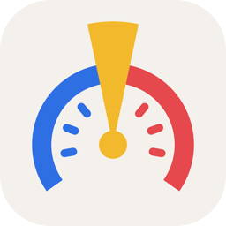
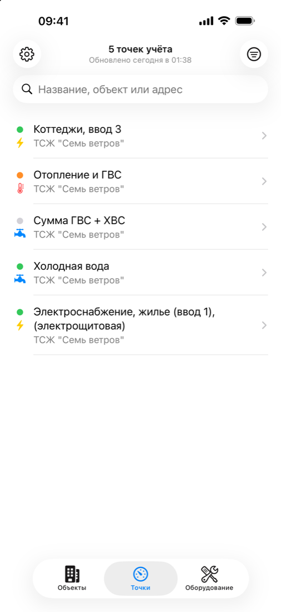
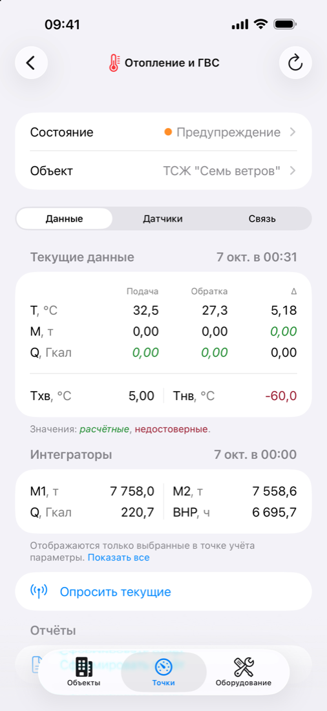
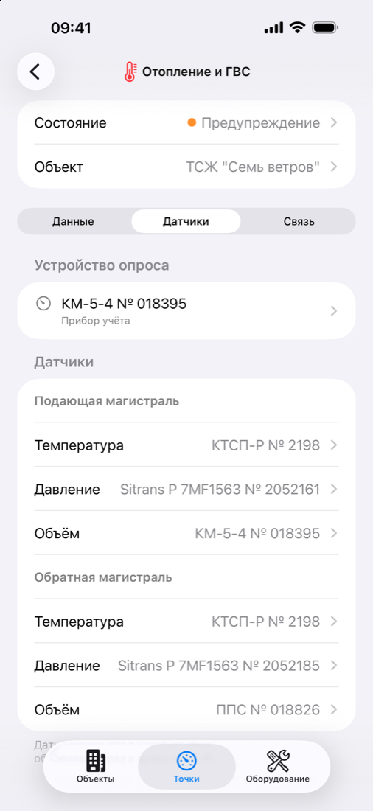
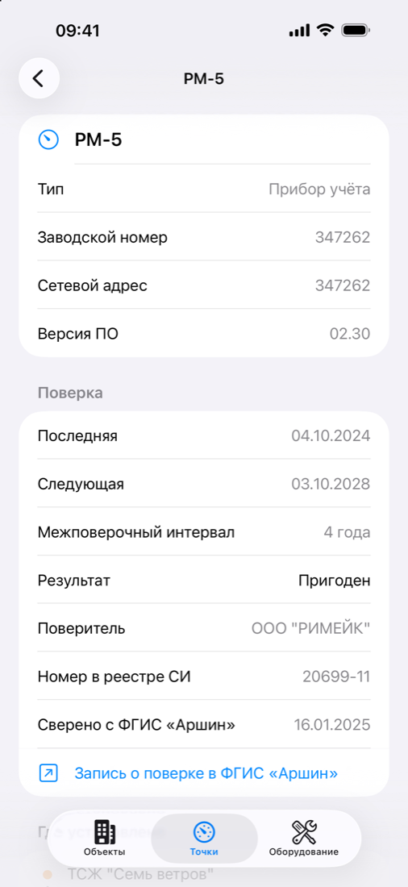
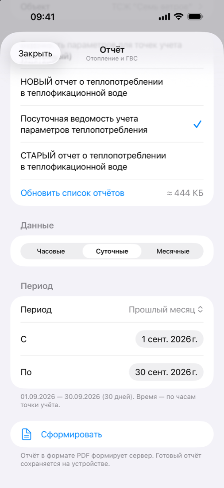
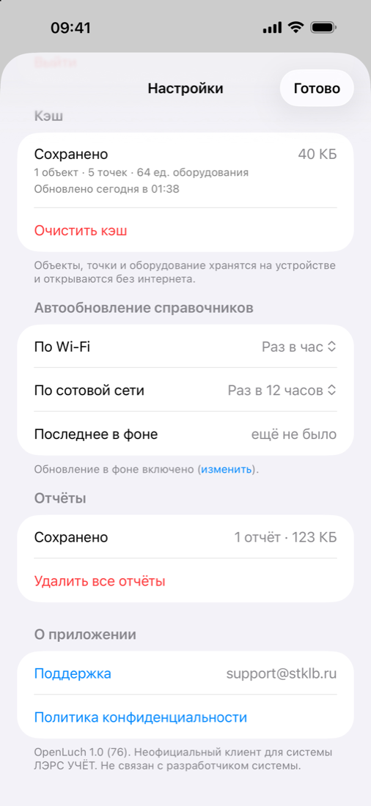

# OpenLuch

Клиент ЛЭРС УЧЁТ для iOS с офлайн-кэшем для работы при плохой связи

---

Нативное SwiftUI-приложение для просмотра данных ЛЭРС УЧЁТ через публичный REST API v1. Справочники кэшируются
на устройстве и обновляются в фоне; при открытии точки учёта запрашиваются только последние данные.

## Скриншоты

<table>
  <tr>
    <td></td>
    <td></td>
    <td></td>
  </tr>
  <tr>
    <td align="center">Точки учёта</td>
    <td align="center">Текущие данные</td>
    <td align="center">Датчики</td>
  </tr>
  <tr>
    <td></td>
    <td></td>
    <td></td>
  </tr>
  <tr>
    <td align="center">Прибор и поверка</td>
    <td align="center">PDF-отчёт</td>
    <td align="center">Настройки</td>
  </tr>
</table>

## Возможности

- Объекты, точки учёта и оборудование из кэша, поиск и фильтры офлайн
- Фоновое обновление справочников (`BGAppRefreshTask`), интервалы отдельно для Wi-Fi и сотовой сети
- Текущие данные и интеграторы; ручной опрос прибора
- Датчики, каналы связи, нештатные ситуации точки
- PDF-ведомости параметров (часовые, суточные, месячные), хранятся на устройстве
- Поверка оборудования, ссылка на запись во ФГИС «АРШИН»
- Вход по логину и паролю, на устройстве хранится только токен (Keychain)

## Планы

- Графики потребления
- Поиск прибора в справочнике по QR-коду свидетельства о поверке
- Работы на объектах учёта
- Push-уведомления о нештатных ситуациях
- Несколько серверов в одном приложении
- Интерфейс для iPad

Квартирный учёт не поддерживается.

## Установка

В App Store приложения пока нет.

### TestFlight

Вы можете участвовать в тестировании. Пришлите на [support@stklb.ru](mailto:support@stklb.ru) свой Apple ID — адрес
электронной почты, к которому он привязан. Мы добавим вас в группу внутренних тестеров в TestFlight. Вам придёт
приглашение: установите приложение [TestFlight](https://apps.apple.com/app/testflight/id899247664) из App Store и
примите приглашение. Новые версии будут приходить через TestFlight автоматически.

### Сборка в Xcode

Нужен Mac с Xcode 26 или новее.

1. Склонируйте репозиторий и откройте `OpenLuch.xcodeproj`.
2. Цель **OpenLuch** → **Signing & Capabilities**: в **Team** выберите свой Apple ID, в **Bundle Identifier** укажите
   свой уникальный идентификатор (например, `com.yourname.openluch`).
3. Подключите iPhone, выберите его вверху окна Xcode и нажмите ▶︎ (Run).

### Сборка .ipa без Mac

`.ipa` собирается в GitHub Actions: сделайте Fork репозитория, в своей копии откройте **Actions** → **Сборка .ipa** →
**Run workflow**. Готовый файл — в разделе **Artifacts** запуска. Локально на Mac то же делает `tools/build-ipa.sh`.

### Что нужно

- iPhone с iOS 18 или новее (также запускается на iPad и на Mac с Apple Silicon).
- Сервер ЛЭРС УЧЁТ с доступом к REST API по HTTPS или HTTP и учётная запись пользователя.
- Попробовать без своего сервера можно на демо-сервере: кнопка «Демо-доступ» на экране входа.

## Поддержать разработку

Приложение бесплатное. Чтобы оно было в App Store и TestFlight, нужна платная подписка Apple Developer — её можно
помочь оплатить через [CloudTips](https://pay.cloudtips.ru/p/6c9eaa2a). Спасибо!

## Как сделан

При разработке для написания кода использовался ИИ-ассистент (модель Claude Opus 5.5). Требования, архитектура, проверка работы с API и тестирование на устройствах — за автором.

## Правовая информация

OpenLuch — **неофициальный** клиент для системы ЛЭРС УЧЁТ. Приложение не связано с разработчиком системы ЛЭРС УЧЁТ и
не поддерживается им. «ЛЭРС УЧЁТ» — товарный знак его правообладателя.

Распространяется по лицензии [MIT](LICENSE): используйте как хотите, только сохраните указание авторства.

© ООО «СОФТКЛАБ»
